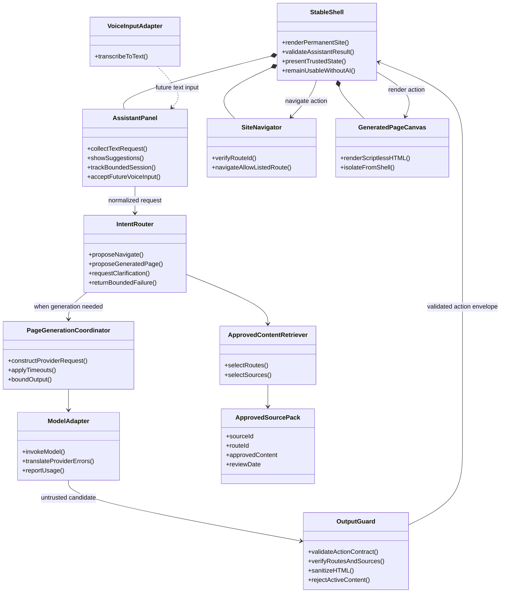
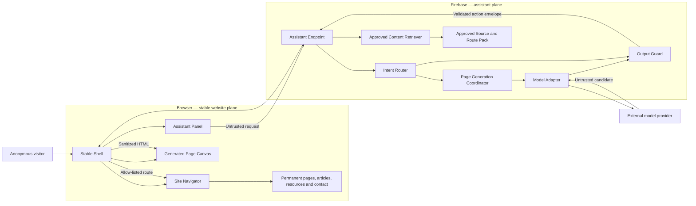
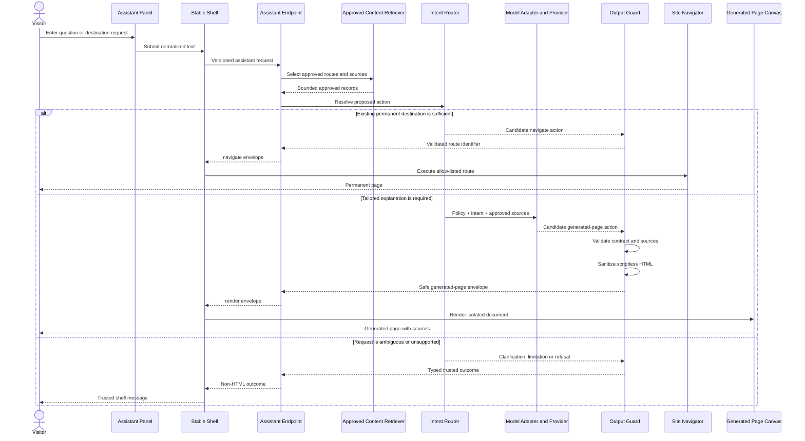
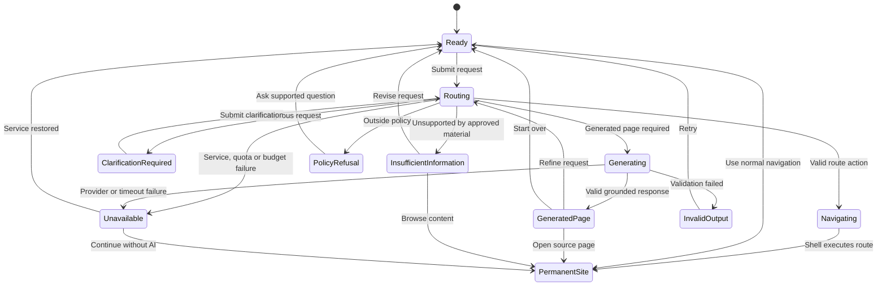

# AI-Assisted Web App UML

**Status:** Implementation reference for the Elustondo.ai proof of concept  
**Scope:** Stable public website, assisted navigation, and bounded generated pages

These models illustrate the component boundaries, request flow, trust boundaries, and visitor-visible states established by the [Product Vision](../../02-intent/product-vision.md), [System Model and Use Cases](../../03-system-model-and-use-cases/conversational-page-generation-system-model-and-use-cases.md), [AI-Assisted Navigation and Page Generation Architecture](../conversational-page-generation-architecture.md), and [Assistant Action Contract](../../08-specifications-as-code/generated-page-contract.md).

The diagrams are specifications, not evidence that the system has been implemented or deployed.

## 1. Structural component model

### Responsibility boundary

- `StableShell` owns identity, trusted UI, routing authority, and availability.
- `AssistantPanel` owns visitor input and bounded interaction state.
- `IntentRouter` proposes an action but never navigates or renders directly.
- `SiteNavigator` executes only shell-owned allow-listed routes.
- `ApprovedContentRetriever` selects reviewed routes and sources.
- `PageGenerationCoordinator` owns the bounded composition workflow.
- `ModelAdapter` isolates provider-specific behavior.
- `OutputGuard` validates every action and fails closed.
- `GeneratedPageCanvas` renders only sanitized scriptless HTML in isolation.
- `VoiceInputAdapter` is a future input adapter, not a separate decision pipeline.

## 2. System and trust-boundary view

The principal trust boundary is the `OutputGuard`. Neither a route nor generated HTML becomes a browser action merely because the model proposed it.

## 3. Navigation or generation sequence

## 4. Visitor-visible state model

## Implementation implications

1. Build the permanent corporate site independently of model connectivity.
2. Treat navigation and page generation as different typed actions.
3. Keep the route allow-list under shell and content-steward control.
4. Preserve normal navigation, downloads, articles, and contact in every assistant state.
5. Keep generation, validation, sanitization, routing, and rendering as separate observable responsibilities.
6. Model voice as a future text-input adapter that enters the same pipeline.
7. Keep future authenticated areas outside the anonymous assistant and generated frame.

## Verification targets

- Permanent public journeys work with the assistant removed or disabled.
- Navigation fixtures can reach only allow-listed local destinations.
- Arbitrary model URLs, unknown route identifiers, unknown sources, and contract mismatches are rejected.
- Generated output cannot execute scripts, submit forms, navigate the parent, access shell state, or imitate authentication controls.
- Clarification and failure outcomes use trusted shell components rather than generated HTML.
- Desktop and mobile presentations expose equivalent information and actions.
