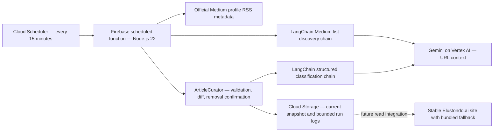

# Elustondo.ai Medium Article Curator and LangChain Architecture --AI

**Document state:** `AI DRAFT — IMPLEMENTATION RECORD; HUMAN REVIEW REQUIRED`
**Date:** 2026-08-03
**Scope:** Sprint 003 Correction 001
**Runtime target:** Firebase Cloud Functions for Firebase, Node.js 22
**Schedule:** Every 15 minutes

## Purpose

This document explains the implemented article-curation proof of concept, the role of LangChain, the Firebase deployment shape, the local test boundary, and the safety rules that keep the public site independent from Medium and Gemini during visitor requests.

The curator periodically observes Pablo's approved public Medium List, preserves canonical article metadata, applies Pablo-owned editorial decisions, uses Gemini through LangChain only where machine classification is required, and writes a last-known-good curated snapshot. It does not fetch Medium or call Gemini when a visitor opens the Articles page.

## Architectural decision

The 15-minute loop is infrastructure scheduling, not an autonomous process that remains alive:

```text
Google Cloud Scheduler
→ starts one Firebase scheduled function
→ the function performs one bounded curator run
→ the function saves a validated snapshot and exits
```

LangChain runs inside that function as installed TypeScript/Node libraries. It constructs the URL-context discovery and structured classification chains, invokes Gemini through Google Cloud credentials, and validates the typed output. LangChain is not a separately hosted server.

## Deployed topology



The current correction implements the scheduled function and snapshot writer. It does not yet connect the public React application to the Cloud Storage snapshot. That integration requires its own acceptance and fallback work; the existing bundled static snapshot remains unchanged.

## Why Medium discovery uses Gemini URL context

Medium documents public RSS feeds for profiles, publications, and topics, but not for Lists. A direct server request to the approved public List returned a Cloudflare challenge during implementation. The curator therefore does not embed a brittle HTML scraper or authentication workaround.

The production source adapter asks Gemini, through LangChain's Google integration and URL-context tool, to open exactly the approved List and return only visible list members. The result is untrusted until the curator validates:

- non-empty bounded membership;
- canonical Medium HTTPS URLs;
- stable Medium post identifiers;
- Pablo Elustondo as author;
- parseable publication time;
- duplicate-free membership;
- matching metadata from Pablo's official Medium profile RSS when that post is present there.

If discovery or validation fails, no candidate replaces the current state.

## LangChain responsibilities

LangChain owns two bounded orchestration chains.

### Medium-list discovery chain

- builds the source-restricted prompt;
- enables Gemini URL context for exactly the approved public List;
- parses JSON through a LangChain output parser;
- passes the untrusted candidate to application validation.

### Article-classification chain

- sends only new or changed article metadata;
- requires structured output;
- permits only `SDLC²`, `Architecture`, and `Modernization`;
- permits multiple pillars or no pillar;
- requires concise subjects, rationale, and confidence;
- rejects missing, duplicate, unknown, or invented classification identities.

Pablo-owned `EDITORIAL_OVERRIDE` classifications always take precedence and survive source metadata changes. Machine classifications are recorded as `LANGCHAIN_GEMINI` and `AI_CURATED` with inspectable rationale.

## Curator responsibilities

`ArticleCurator` owns the deterministic application policy around the model:

1. load the last-known-good state;
2. discover and validate current Medium-list membership;
3. normalize canonical identifiers and metadata;
4. compare the observation with the previous state;
5. require the same removal set in two consecutive successful observations;
6. classify only new or changed records without editorial overrides;
7. preserve manual classifications;
8. write the new state and a bounded run record;
9. fail without replacing the current state when any source, model, schema, or storage boundary fails.

Two consecutive observations mean that a real removal normally becomes effective after approximately 15 to 30 minutes, while one incomplete observation cannot erase public material.

## Storage and observability

The Firebase adapter writes:

```text
article-curator/current.json
article-curator/runs/<timestamp>-<run-id>.json
```

Run records contain only bounded operational facts: status, counts, article identifiers, timestamps, and a safe message. They do not contain Google credentials, authorization headers, raw model prompts, private material, or full model responses.

The local adapter writes the same logical state to an explicitly selected local directory and uses an atomic file replacement.

## Local verification

Local verification does not require Firebase, Medium, Gemini, credentials, or billing. A deterministic source fixture and classifier exercise the same `ArticleCurator` and storage contracts used by the scheduled function.

The principal local demonstration starts from the five-article bootstrap state while the source fixture omits `The Three Amigos Agent Architecture`:

```text
Run 1 → removal is pending; five articles remain
Run 2 → identical removal confirmed; four articles remain
```

Live URL-context and Vertex AI behavior remain a controlled cloud-integration gate because no credential, API activation, billable call, or deployment was authorized for this correction.

## Runtime and credential boundary

- Firebase runtime: Node.js 22 in `northamerica-northeast1`.
- Function concurrency: one request per instance and at most one instance, preventing overlapping curator runs.
- Gemini model: configurable; the code defaults to `gemini-2.5-flash-lite`.
- Production authentication: Google Application Default Credentials supplied by the managed Cloud Function identity.
- No API key or credential is stored in the repository.
- Vertex AI, Cloud Scheduler, Cloud Functions, Cloud Storage, Firebase billing, IAM, and deployment remain operational approval gates.

## Invocation volume

An exact 15-minute schedule produces up to 96 scheduled runs per day. The discovery chain may therefore make up to 96 Gemini URL-context calls daily, while the classification chain runs only for new or changed articles that do not have a preserved editorial override. This is more than “a few calls per day” and must be included in the future cost and quota review.

## Failure behavior

| Failure | Required outcome |
|---|---|
| Medium List unreadable | Preserve current snapshot; log bounded failure |
| Profile RSS unavailable | Preserve current snapshot; log bounded failure |
| Empty, malformed, or duplicate membership | Preserve current snapshot |
| Gemini classification invalid | Preserve current snapshot |
| One observed removal | Keep article and record pending removal |
| Storage write failure | Treat run as failed; do not claim publication |
| Curator unavailable | Permanent website and bundled article snapshot remain usable |

## Current limits and next gates

- The real Gemini URL-context access to this Medium List has not been executed.
- The real Firebase Storage adapter has not been exercised against an emulator or cloud project.
- The actual Cloud Scheduler wake-up has not been deployed or observed.
- The public React application does not yet read the cloud snapshot.
- Cost, budgets, quotas, IAM, kill switch, alerting, and rollback remain to be approved before cloud activation.

These limits are deployment and integration-test boundaries, not hidden completion claims.

## Primary implementation locations

- `functions/src/index.ts` — scheduled Firebase wrapper;
- `functions/src/article-curator/production.ts` — deployable dependency composition;
- `functions/src/article-curator/medium-source.ts` — URL-context discovery and RSS cross-check;
- `functions/src/article-curator/langchain-classifier.ts` — structured classification chain;
- `functions/src/article-curator/curator.ts` — deterministic curation policy;
- `functions/src/article-curator/store.ts` — Firebase and local persistence adapters;
- `functions/src/local-runner.ts` — credential-free local demonstration.

## References

- [Firebase scheduled functions](https://firebase.google.com/docs/functions/schedule-functions)
- [Firebase local Functions emulator](https://firebase.google.com/docs/functions/local-emulator)
- [LangChain ChatGoogle integration](https://docs.langchain.com/oss/javascript/integrations/chat/google)
- [Medium supported RSS feeds](https://help.medium.com/hc/en-us/articles/214874118-Using-RSS-feeds-of-profiles-publications-and-topics)
