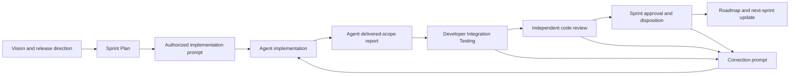

# Elustondo.ai Sprint Documentation and Governance Model

**Status:** Governance baseline for review  
**Applies to:** Elustondo.ai website implementation sprints  
**Authority:** Pablo Elustondo  
**Important:** This document defines the process. It does not activate a sprint or authorize implementation, dependency installation, Git actions, deployment, billing, credentials, or DNS changes.

## 1. Purpose

Elustondo.ai should be built through small, bounded, independently reviewable sprints. Each sprint must leave a durable record that distinguishes:

- what Pablo authorized;
- what the implementation agent attempted;
- what the agent claims it completed or postponed;
- what was independently executed and observed;
- what the code reviewer concluded;
- what Pablo finally accepted, deferred, rejected, or returned for correction.

This model adapts the strongest methodological rules used by VISTA to the needs of a web application. It preserves evidence and accountability without reproducing unnecessary mobile-device or Xcode-specific procedures.

The central principle is:

> The roadmap provides direction, the Sprint Plan authorizes a bounded increment, implementation produces a claim, testing and review produce evidence, and sprint approval records the human decision.

## 2. Planning levels

The project uses four different planning levels. They must not be collapsed into one document.

### 2.1 Product Vision

The Product Vision explains why Elustondo.ai exists, who it serves, which problems it addresses, and the long-term experience the company intends to provide.

Canonical location:

```text
docs/02-intent/product-vision.md
```

The vision is durable and strategic. It is not a sprint backlog and does not authorize code changes.

### 2.2 Release Plan

The Release Plan defines meaningful product releases, their intended outcomes, their release gates, and the relationship among development, Firebase preview, public launch, and later capabilities.

Canonical location:

```text
docs/07-planning/release-plan.md
```

A release may require several sprints. Sprint approval does not automatically approve a release.

### 2.3 Sprint Roadmap

The Sprint Roadmap provides a rolling sequence of likely increments. It indicates direction and dependencies but remains adjustable.

Canonical location:

```text
docs/07-planning/sprint-roadmap.md
```

The exact next sprint should be selected only after reviewing the evidence, deferrals, defects, risks, and lessons from the sprint that just closed. A roadmap entry is not an active work order.

### 2.4 Sprint Package

A Sprint Package is the complete record for one authorized increment. It contains the plan, prompt, agent claim, independent integration-test report, code-review report, approval, corrections, and evidence.

Canonical location:

```text
docs/07-planning/sprints/sprint-NNN-short-name/
```

## 3. Component architecture prerequisite

Every sprint must identify the component it is authorized to modify. A sprint should normally affect one component or one tightly related integration boundary.

Elustondo.ai already has a preliminary component architecture in:

- [AI-Assisted Navigation and Page Generation Architecture](../06-solution-design-and-architecture/conversational-page-generation-architecture.md)
- [Conversational Web App UML](../06-solution-design-and-architecture/uml/conversational-web-app-uml.md)

The current architectural participants are:

- `StableShell`;
- `AssistantEndpoint`;
- `IntentRouter`;
- `SiteNavigator`;
- `ApprovedSourcePack`;
- `ModelAdapter`;
- `OutputGuard`;
- `GeneratedPageCanvas`.

Before component-scoped implementation begins, this architecture should be strengthened with a component catalogue and lightweight responsibility cards:

```text
docs/06-solution-design-and-architecture/
└── components/
    ├── README.md
    ├── component-catalog.md
    └── responsibility-cards/
        ├── stable-shell.md
        ├── question-experience.md
        ├── generation-endpoint.md
        ├── approved-source-pack.md
        ├── model-adapter.md
        ├── output-guard.md
        └── sandboxed-renderer.md
```

Each significant component card should state:

- purpose and primary responsibility;
- responsibilities it owns;
- responsibilities it explicitly does not own;
- collaborators and dependency direction;
- inputs, outputs, and public contracts;
- authority and trust boundaries;
- failure and uncertainty outcomes;
- test seams and acceptance evidence;
- observability responsibilities;
- relevant use cases and specifications.

A component name or diagram is not proof that the component exists in code. Documentation, implementation, tests, runtime evidence, and review must remain consistent.

## 4. Canonical sprint-folder structure

All documents and bounded evidence for a sprint should live together:

```text
docs/
└── 07-planning/
    ├── release-plan.md
    ├── sprint-roadmap.md
    └── sprints/
        ├── README.md
        ├── sprint-001-deterministic-shell/
        │   ├── README.md
        │   ├── 01-sprint-plan.md
        │   ├── 02-authorized-implementation-prompt.md
        │   ├── 03-agent-delivered-scope-report.md
        │   ├── 04-developer-integration-test-report.md
        │   ├── 05-code-review-report.md
        │   ├── 06-sprint-approval-and-disposition.md
        │   ├── evidence/
        │   │   ├── README.md
        │   │   ├── automated-tests/
        │   │   ├── build-results/
        │   │   ├── browser-and-responsive/
        │   │   ├── accessibility/
        │   │   └── screenshots/
        │   └── corrections/
        │       ├── correction-01-prompt.md
        │       └── correction-01-agent-response.md
        ├── sprint-002-short-name/
        └── sprint-003-short-name/
```

The numbered files establish the reading and decision order. The sprint `README.md` is the package manifest. The `evidence/` and `corrections/` directories are created only when needed.

Sprint-specific artifacts should not be duplicated into other numbered SDLC² folders. The Build and Test and Review and Release indexes may link to the canonical sprint reports.

## 5. Sprint package manifest

Each sprint-folder `README.md` should identify:

- sprint number and name;
- current workflow state;
- product goal;
- authorized component or integration boundary;
- expected start and completion dates, if known;
- repository and branch;
- baseline and review commit identifiers;
- release or roadmap relationship;
- links to all six mandatory sprint documents;
- evidence index;
- correction rounds;
- final disposition;
- accepted postponed work and its destination.

The manifest is an index and state summary. It must not replace the six substantive documents.

## 6. Six mandatory sprint documents

### 6.1 `01-sprint-plan.md` — Authorized intent

The Sprint Plan defines what the team intends to build now. It is narrower than the Product Vision, Release Plan, and Sprint Roadmap.

It must include:

- problem and sprint goal;
- relevant product intent and use cases;
- authorized component or integration boundary;
- current behavior and desired behavior;
- acceptance criteria or benchmark;
- expected automated and integration tests;
- required observability and evidence;
- allowed files or repository boundaries when known;
- dependencies and assumptions;
- explicit non-goals;
- stop conditions;
- Git, deployment, credential, billing, and DNS authorization status.

The Sprint Plan is the authorization boundary. An implementation agent may not silently broaden, narrow, or reinterpret it.

### 6.2 `02-authorized-implementation-prompt.md` — Immutable work order

The implementation prompt converts the approved Sprint Plan into an executable assignment for Claude, Codex, or another implementation agent.

It must include:

- exact repository and required preflight;
- mandatory reading order;
- sprint goal and declared component;
- allowed and prohibited scope;
- required implementation behavior;
- required RED/GREEN, build, lint, type-check, browser, accessibility, or security checks;
- evidence paths;
- required delivery-report path;
- stop and escalation conditions;
- explicit Git and deployment authority.

Once execution begins, the agent must not edit its own work order. A required scope correction is recorded as a separate correction prompt.

### 6.3 `03-agent-delivered-scope-report.md` — As-built claim

The implementation agent produces this document after work stops. It is a claim about the delivered state, not approval.

Every planned item must be classified as one of:

- completed;
- partially completed;
- postponed or deferred;
- not implemented;
- changed;
- replaced.

The report must also disclose unplanned additions.

It should include:

- repository, branch, baseline, and final working revision;
- components and files changed;
- implemented behavior;
- fixture, simulation, placeholder, or incomplete behavior;
- tests and checks executed, with results;
- evidence paths;
- deviations from the Sprint Plan and reasons;
- known defects, risks, and limitations;
- recommended reviewer focus;
- final agent workflow state;
- confirmation of whether any commit, push, merge, deployment, credential, billing, or DNS action occurred.

The agent may disclose postponement, but it cannot approve its own deviation. Pablo decides whether the postponement is acceptable.

### 6.4 `04-developer-integration-test-report.md` — Independent observed behavior

Developer Integration Testing is the first independent execution gate. For ordinary trusted feature work, it happens before deep code review so expensive review time is not spent on a change that does not build or perform its principal flow.

The test report should identify:

- repository, branch, exact commit, and worktree condition;
- build environment and relevant tool versions;
- build, type-check, lint, and automated-test results;
- executed user journeys and fixture states;
- desktop and mobile browser coverage;
- responsive widths, including 320 CSS pixels;
- keyboard and accessibility observations;
- generated-page sandbox and containment checks when applicable;
- screenshots, logs, reports, and CI references;
- comparison among planned scope, agent claim, and observed behavior;
- regressions;
- environment blockers distinguished from application defects;
- final result: `PASS`, `PASS WITH FINDINGS`, `FAIL`, or `BLOCKED`.

Visible success is not sufficient evidence for persistence, isolation, security, accessibility, or deployment claims. Each claim requires evidence at the appropriate boundary.

### 6.5 `05-code-review-report.md` — Independent structural judgment

Code review begins after the implementation claim and integration-test evidence are available.

The mandatory review order is:

```text
Scope identity
→ Product intent
→ Use cases and boundaries
→ Acceptance benchmark
→ Component architecture
→ Implementation
→ Tests
→ Observability and evidence
→ Documentation
```

The review should distinguish:

- missing required elements;
- prohibited elements present;
- regressions introduced by the sprint;
- unrelated pre-existing debt;
- blocking findings;
- non-blocking findings;
- facts, inferences, and unresolved questions.

The report must use one unambiguous recommendation:

- `APPROVED FOR INTEGRATION`;
- `APPROVED FOR INTEGRATION WITH MINOR FINDINGS`;
- `CHANGES REQUIRED`;
- `REJECTED — CLAIMS NOT SUPPORTED`;
- `BLOCKED — INSUFFICIENT INFORMATION OR EVIDENCE`.

The implementing agent must not be the independent approver of its own work.

### 6.6 `06-sprint-approval-and-disposition.md` — Human decision

This document reconciles the complete sprint record:

1. Sprint Plan;
2. agent delivered-scope claim;
3. Developer Integration Testing;
4. preserved evidence;
5. code-review findings;
6. benchmark or acceptance result;
7. postponed work and discovered risks.

The final disposition should be one of:

- `APPROVED`;
- `APPROVED WITH EXPLICIT DEFERRALS`;
- `CHANGES REQUIRED`;
- `REJECTED`;
- `BLOCKED`.

Approval must identify what is accepted, what remains incomplete, which findings are accepted as debt, what moves to the roadmap or next sprint, and which Git or integration action is now authorized.

Sprint approval does not automatically authorize Firebase deployment, production release, provider billing, credential configuration, public-domain promotion, or DNS changes.

## 7. Sprint lifecycle



The roadmap says where the product intends to go. Sprint closure establishes where the product actually is. The next Sprint Plan must reconcile both.

## 8. Workflow states

Each sprint manifest should use one of these states:

| State | Meaning |
|---|---|
| `DRAFT` | The sprint package is being designed and is not authorized. |
| `READY` | Pablo has explicitly authorized the Sprint Plan and implementation prompt. |
| `IN_PROGRESS` | An implementation agent is executing the authorized prompt. |
| `AWAITING_INTEGRATION_TEST` | The agent report is complete and ready for independent execution. |
| `AWAITING_CODE_REVIEW` | Integration testing produced sufficient evidence for deep review. |
| `AWAITING_APPROVAL` | Testing and review are complete; Pablo’s disposition is required. |
| `CHANGES_REQUIRED` | A bounded correction package is required. |
| `BLOCKED` | Work cannot continue safely; reason and evidence are preserved. |
| `APPROVED` | Pablo accepted the sprint result and any explicit deferrals. |
| `CLOSED` | Authorized integration actions and final records are complete. |

A document that describes a future sprint does not place it in `READY`. Only Pablo’s explicit authorization can activate a sprint.

## 9. Evidence rules

Evidence must be attributable, reproducible, and proportionate.

- Record the exact branch and commit for every executed result.
- Distinguish uncommitted worktree evidence from committed or CI evidence.
- Preserve original screenshots, logs, reports, and test summaries; add analysis without overwriting originals.
- Do not claim that a test passed when only a command was proposed or scheduled.
- Do not claim deployment from a successful local build.
- Do not claim production behavior from a fixture, simulation, preview, or mocked provider.
- Do not store secrets, credentials, access tokens, private visitor prompts, or unnecessary personal information.
- Prefer concise evidence summaries in Git. Link large or ephemeral CI artifacts through an evidence manifest rather than committing uncontrolled build output.
- Record environment failures separately from application defects.

## 10. Corrections and postponed work

Corrections must preserve the historical record.

- Do not rewrite the original Sprint Plan or implementation prompt after execution begins.
- Add `correction-NN-prompt.md` and `correction-NN-agent-response.md` under the sprint’s `corrections/` directory.
- Re-run the affected integration tests and review gates.
- Tie new evidence to the corrected commit.
- Update the final approval only after the correction record is complete.

Postponed work must be explicit. It must be accepted, rejected, or routed to one of:

- the current sprint correction package;
- a named future sprint;
- the Sprint Roadmap;
- the product backlog;
- an architecture decision or research task.

An agent cannot erase mandatory scope merely by labeling it postponed.

## 11. Authority boundaries

- Pablo owns product direction, sprint authorization, acceptance of deviations, sprint approval, consequential Git actions, release authorization, provider billing, and DNS cutover.
- The implementation agent owns accurate execution and an honest delivered-scope report.
- The integration tester owns independent execution and observable evidence.
- The code reviewer owns the independent structural assessment.
- No implementing agent may approve its own work.
- A planning document, roadmap item, folder, placeholder, mockup, or prompt draft is not authorization to execute.

## 12. Adoption sequence

The proposed adoption order is:

1. Approve this governance model.
2. Review and approve the Product Vision.
3. Create the Release Plan.
4. Create the rolling Sprint Roadmap.
5. Complete the component catalogue and responsibility cards.
6. Create `docs/07-planning/sprints/README.md` as the sprint registry.
7. Create the `sprint-001-deterministic-shell` package.
8. Review and explicitly authorize its Sprint Plan and implementation prompt.
9. Begin implementation only after authorization.

## 13. VISTA methodological sources

This model was informed by read-only review of the following VISTA artifacts:

- [Sprint Planning, Developer QA, Code Review, and Integrated Change Validation](https://drive.google.com/file/d/1d2Pf789RLdaynYQWsy_3ncnEhnmqIdev/view)
- [Code Review Standard and Reviewer Instructions](https://drive.google.com/file/d/1z4myfMSOsBxYpjkhXDbSrZyVnv2iuxEr/view)
- [Agentic Work Execution Protocol](https://drive.google.com/file/d/1icpj2JOoj2jJOkSk18z-rWoQCs4oIGxq/view)
- [Architecture, Component Responsibility, and Code Documentation Specification](https://drive.google.com/file/d/1UiMB9-eaMjzmK9dNSfiMzwUl_0FOGo6s/view)
- [Sprint 7C2 Prompt — C07 Evidence Integrity Closure](https://drive.google.com/file/d/1J7yM5UeXYFR7gsWYnMQMwsZUgapuI3au/view)
- [Sprint 7C2 Test Evidence](https://drive.google.com/file/d/1LxACnQvYgDwhbWvCdclh7E6yipRtrgAm/view)

Elustondo.ai adopts the methodological responsibilities, evidence boundaries, and independent approval principles while tailoring the testing evidence to a responsive Firebase-hosted web application.
